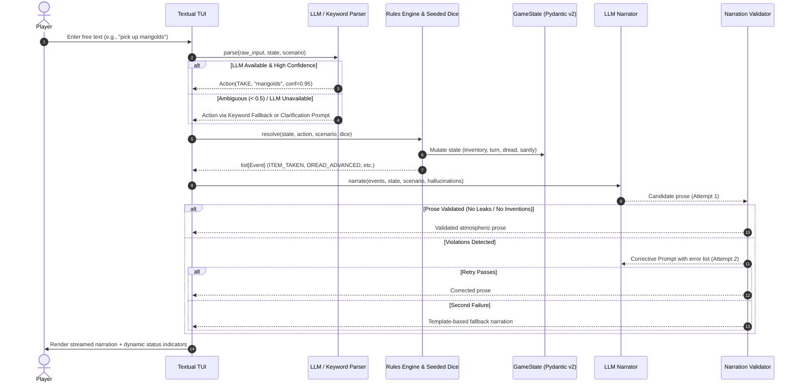

# Dread Engine: Architecture & Technical Design

## 1. Core Architectural Invariant

The central design principle of **Dread Engine** is that **the local LLM never owns game state**.
A deterministic Python rules engine acts as the authoritative single source of truth for all spatial coordinates, inventory holdings, psychological sanity, dread progression, entity manifestations, and dice rolls.

The local Large Language Model performs exactly two roles:
1. **Parser:** Translating unstructured natural language player inputs into structured, typed `Action` objects matching a strict schema.
2. **Narrator:** Translating the engine's structured `Event` logs into sensory, evocative second-person horror prose.

Between the Narrator and the player stands the **Validator**, which intercepts every token and rejects any prose that invents objects, leaks spoilers of undiscovered rooms, or injects out-of-character meta text.

---

## 2. The Turn Loop

---

## 3. Component Breakdown

### 3.1 Rules Engine & GameState (`dread/engine/`)
- **`state.py`**: Immutable-by-design Pydantic v2 models representing the entire universe snapshot (`GameState`, `Action`, `Event`, `TurnRecord`).
- **`rules.py`**: Pure, deterministic action resolver implementing all 15 verbs (`LOOK`, `EXAMINE`, `GO`, `TAKE`, `DROP`, `USE`, `USE_ON`, `TALK`, `HIDE`, `WAIT`, `REST`, `INVENTORY`, `HELP`, `SAVE`, `QUIT`).
- **`dice.py`**: Seeded pseudo-random number generator (`DreadDice`). Calling rolls deterministically guarantees that replays will evolve identically.
- **`clock.py`**: Bounded Dread Clock (0–10). Each turn or risky action advances the clock. At dread 10, the scenario's supernatural entity activates, inflicting physical or mental trauma and resetting tension.
- **`sanity.py`**: Maps numerical sanity (0–100) to four psychological tiers:
  - **Stable** ($\ge 70$): Grounded, observational prose.
  - **Uneasy** ($40 - 69$): Hypervigilant tension, subtle shadows.
  - **Unraveling** ($15 - 39$): Claustrophobia, auditory unease, low-probability hallucinations.
  - **Breaking** ($< 15$): Reality distortion, visual flicker, high-probability hallucinations.
- **`endings.py`**: Evaluates terminal win/loss conditions against flags, items, locations, and mortal thresholds.

### 3.2 Local LLM Subsystem (`dread/llm/`)
- **`client.py`**: Provider-agnostic abstraction (`BaseLLMClient`) supporting:
  - `OllamaClient` (default local HTTP API at `http://127.0.0.1:11434`)
  - `LlamaCppClient` (for `llama.cpp-server`)
  - `MockLLM` (for zero-latency offline unit testing and headless validation)
- **`parser.py`**: Leverages constrained JSON schema generation to extract intent, targets, and confidence scores.
- **`narrator.py`**: Converts emitted `Event` instances into 2–5 sentences of atmospheric horror prose adhering to the scenario's persona.
- **`validator.py`**: Verifies candidate narration against visible state. Enforces four cardinal rules:
  1. *Entity Containment:* No unencountered supernatural entities may be described.
  2. *Item Isolation:* No items outside the player's inventory or current location may be referenced.
  3. *Spatial Integrity:* Distant chambers cannot be described as present.
  4. *Meta-Immunity:* Phrases like "as an AI", "game master", or "roll a d20" trigger immediate rejection.
- **`fallback.py`**: Offline keyword parser and template narrator ensuring the engine never crashes or stalls even if the LLM process is terminated mid-game.

### 3.3 Scenarios & Schemas (`dread/scenarios/`)
- Scenarios are declarative YAML files parsed into strictly validated Pydantic schemas (`Scenario`, `Location`, `Item`, `Entity`, `Clue`, `Ending`, `Persona`).
- Automated referential integrity checks verify all exits, items, and clues point to existing nodes before gameplay starts.

### 3.4 Terminal User Interface (`dread/ui/`)
- Built on `Textual`, featuring:
  - Live status bar with heart counters, skull dread tracks, and sanity tier tags.
  - Ambient terminal visual flicker at low sanity tiers.
  - "Offline Fallback" badge indicating when the model has yielded to deterministic templates.
  - Disambiguation suggestion buttons on ambiguous input.
  - Collapsible audit drawer showing raw engine events and validator rejection logs.
